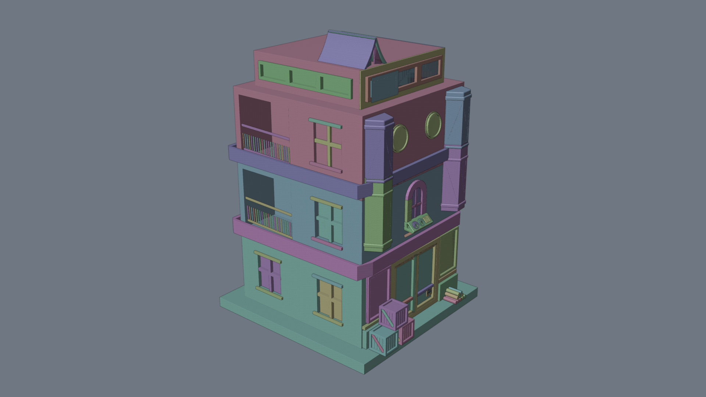
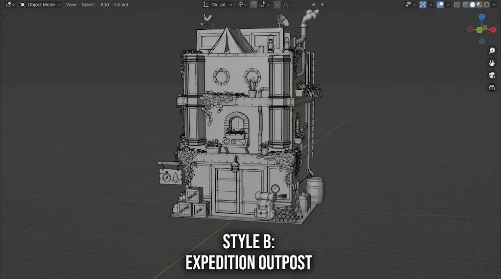
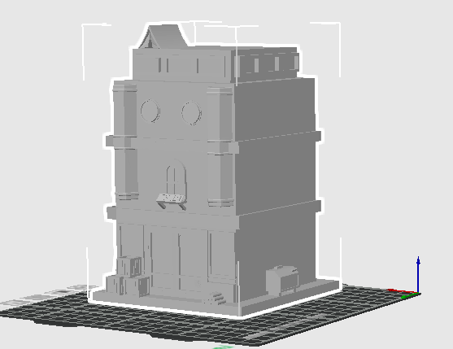

# Expedition Outpost 

A 3D-printable 3-story miniature outpost with a rooftop camping tent and street props, modeled in Blender for **Hack Club Embassy**.

[](./journal.md)
[](./GUIDE.md)
[](./LICENSE)
[](https://www.printables.com/model/1930053-expedition-outpost)
[](https://hackatime.hackclub.com/?project=expedition+outpost)
[-brightgreen.svg)](#suggested-print-settings)

- **Printables:** [expedition-outpost](https://www.printables.com/model/1930053-expedition-outpost) 
- **Hackatime:** [expedition outpost](https://hackatime.hackclub.com/?project=expedition+outpost) (**7h 47m 56s** total across 7 sessions)
- **Lapse:** *([fluci lapse](https://lapse.hackclub.com/user/@fluci))*
> ⚠️
> **Time & Verification Disclaimer:**
> - **Lapse (Video Timelapses):** `7h 47m 56s` across 7 recorded Blender modeling sessions, But in hackatime lapse time is showing wrong!!
> - **Total Combined Time is:** `~10h 32m` when including the additional Hackatime/documentation and (`~2.47h` outside the journal readme and etc work).



## Model perspective

Across its three levels, the outpost includes:
- **Ground Floor:** Layered entrance gates, shop awning, curbside dustbin, hollow slatted crates, and campfire logs.
- **Second Floor:** Floor divider belts, 7-sided cylinder windows, walkout balconies with safety grills, and the **Walking Window** (an arched window with a lap shelf, little legs, and direction compasses).
- **Third Floor:** Outpost "eyes", a rooftop chimney, and a two-part bent camping tent with triangular door flaps.

| Starting Idea (Pinterest) |  (Expedition Outpost) |
| :---: | :---: |
|  |  |

## Why I Made This

After completing the old devil home one, I wanted to expand the miniature town with a taller, multi-story building that had more personality and storytelling. Also via which i can brothen my skills , Starting from an normall Pinterest image which made it easy to block out the three floors and windows, I moved halfway into an expedition outpost gave me an excuse to use more tools and give it a whole personality to it . and this led to the birth of Expedition Outpost

## Files in This Repo

- `src/orange home.blend` — main 3-story building Blender scene
- `src/otherassets.blend` — Walking Window, compasses, crates, campfire logs & dustbin
- `src/Tent.blend` — rooftop camping tent model
- `production/expedition_outpost_printable.stl` — print-ready STL (`10.7 × 11.2 × 16.3 cm`)
- `GUIDE.md` — setup, slicer settings & painting walkthrough
- `journal.md` — full 7-session modeling log and hurdles
- `BOM.csv` — filament weight and cost breakdown

```text
├── src/
│   ├── orange home.blend                 # main 3-story building scene
│   ├── otherassets.blend                 # crates, logs, compasses, walking window
│   └── Tent.blend                        # rooftop camping tent model
├── production/
│   └── expedition_outpost_printable.stl  # 16.3 cm 3D-printable STL
├── renders/                              # Workbench renders
├── journal_media/                        # progress screenshots & references
├── GUIDE.md                              # setup, slicing & printing guide
├── journal.md                            # complete 7-phase build diary
├── BOM.csv                               # materials cost list
├── AI_USAGE.md                           # AI disclosure statement
├── README.md                             # project overview
└── LICENSE                               # MIT License
```

## Modeling (CAD)

Modeled in Blender across **7 sessions (7h 47m 56s total)** tracked in Lookout/Lapse, starting from a ground plane with `I` (Inset) and `P` (Separate) to extrude the three floors and carve the upper windows. From there I added the front entrance gates, wrapped floor divider belts (`Shift + D` + `Bridge Edge Loops`), shaped the 7-sided cylinder windows and side balconies, built the Walking Window (`Spin` + `Bridge Edge Loops` arch, cross bars, lap, and legs), dustbin, chimney, compass dials, slatted `Alt + E` crates, campfire logs, `P`-split bent rooftop tent, and balcony safety grills—bringing everything together into **1 outpost composed of 185+ individual mesh pieces**.


Full step-by-step build log and screenshots: [`journal.md`](./journal.md)

## Rendering & Colors

To showcase both the individual hand-modeled components and the overall form, I rendered the outpost in Blender's **Workbench** engine using two styles: **Solid Random Components** (each sub-piece colored in a distinct pastel shade) and **Colorless Architectural White** (clean matte lighting highlighting depth, edges, and silhouettes).

| Solid Random Components | Colorless Architectural White |
| :---: | :---: |
|  |  |

## 3D Printing

All 3 `.blend` scenes were combined into [`production/expedition_outpost_printable.stl`](./production/expedition_outpost_printable.stl) with the base leveled flat at `Z = 0.0 mm` and thin railings/frames prepped for FDM printing (AI assistance for STL prep and rendering is documented in [`AI_USAGE.md`](./AI_USAGE.md)). Because I don't own a 3D printer yet, this hasn't been physically test-printed—dimensions, volume, and filament estimates are verified directly from the STL and slicer checks.

### Suggested Print Settings



Full setup, slicing, and finishing steps are in [`GUIDE.md`](./GUIDE.md):
- **Size:** `16.3 cm` tall (`107.2 × 112.1 × 163.3 mm` / `10.7 × 11.2 × 16.3 cm`) — keep at 100% scale so thin window bars and slats stay above a `0.4 mm` nozzle width
- **Layer height:** `0.20 mm` (or `0.16 mm` for sharper details)
- **Walls / Perimeters:** `3 walls`
- **Infill:** `15% Gyroid`
- **Supports:** Tree / Organic supports (needed under the shop awning and balcony overhang)
- **Estimated time:** `~10–12 hours`

## Parts & Cost

Estimated material cost using Numakers India PLA+ filament at ₹600/kg (**~323 g** for the model + **~22 g** for tree supports = **~345 g total**, or **$2.24 USD / ₹207**). Modeled in Blender and checked for slicing in Bambu Studio (both free). 

Source file: [`BOM.csv`](./BOM.csv)

| Item | Quantity | Price | Link to Buy |
| :--- | :--- | :--- | :--- |
| PLA+ Filament (Outpost Model) | ~323g | $2.10 (₹194) | [Numakers PLA+](https://india.numakers.com/products/pla-filament) |
| PLA+ Filament (Tree Supports) | ~22g | $0.14 (₹13) | [Numakers PLA+](https://india.numakers.com/products/pla-filament) |
| **Total Estimated Material Cost** | **16.3cm Miniature (~345g)** | **$2.24 USD (₹207)** | *Estimated raw filament (15% Gyroid + supports)* |

---

Made for [Hack Club Embassy](https://embassy.hackclub.com) using Blender · Licensed under [MIT](./LICENSE).
