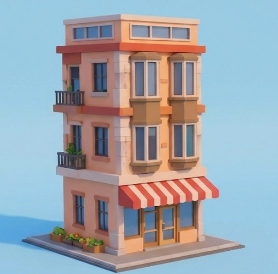
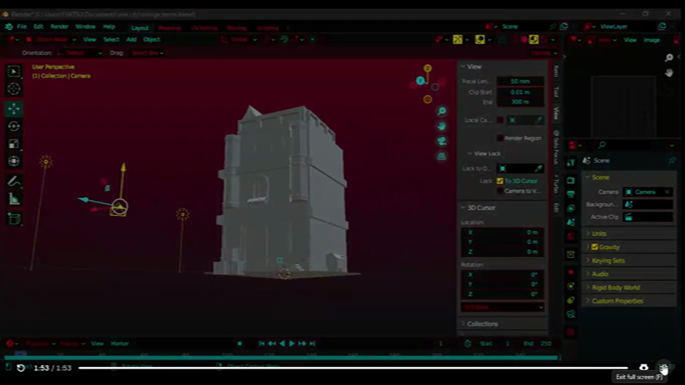
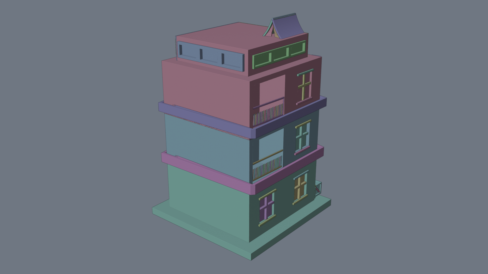
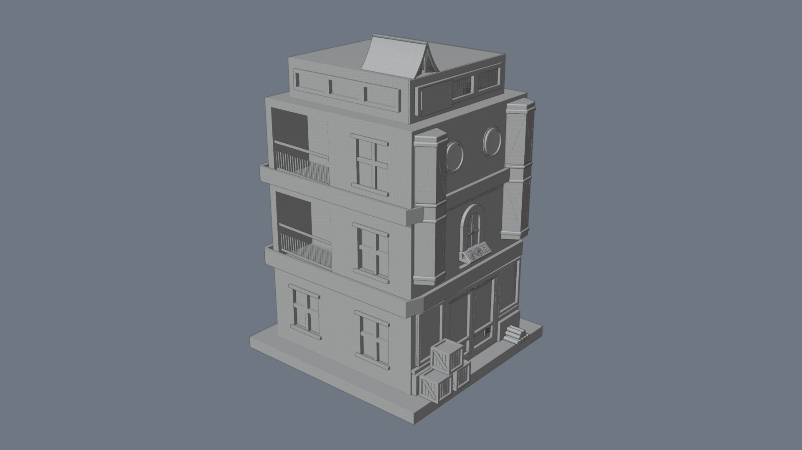

# Expedition Outpost

A 3D-printable miniature of a really coolish outpost, modeled in Blender for **Hack Club Embassy**.

[](./journal.md)
[](./GUIDE.md)
[](./LICENSE)
[](https://www.printables.com/model/1930053-expedition-outpost)
[](https://hackatime.hackclub.com/?project=expedition+outpost)
[-brightgreen.svg>)](#suggested-print-settings)

- **Printables:** [expedition-outpost](https://www.printables.com/model/1930053-expedition-outpost)
- **Hackatime:** [expedition outpost](https://hackatime.hackclub.com/?project=expedition+outpost) (**7h 47m 56s** total across 7 sessions)
- **Lapse:** _([fluci lapse](https://lapse.hackclub.com/user/@fluci))_

> **Time & Verification Note:**
>
> - **Lapse (Video Timelapses):** `7h 47m 56s` across 7 recorded Blender modeling sessions, but in Hackatime the lapse time is showing wrong!!
> - **Total Combined Time:** `~10h 32m` when including the additional Hackatime/documentation (`~2h 44m` outside the journal, README, etc.).


## Models Overview

hellos here's an overview of this really cooler than the Alaska outpost , it's a damn cozy and stylish outpost which started off with a Pinterest inspo to be exact which I found while in search of something where I can practice more and improve my skill , That being said halfway through I didn't want it to be a Random Generic model so I used the help of AI.

Halfway through I used the magic wand (which is the free AI model). I wanted to give the home really cool outdoor camp vibes (credit- inspired by new survive ysws tbh), so at the end we got (**Style B: Expedition Outpost**) and midway we got a new mission to turn THIS INTO EXPEDITION OUTPOST.

Basically, it's a 3-story building that you can live in and camp out on top of. It's packed with a rooftop camping tent, wooden shipping boxes, campfire logs, safety railings, and a Walking Window, the nose of the outpost.

Across its three floors, here is what's on the outpost:

- **Ground Floor:**
  - Front gate doors
  - The windows
  - Wooden boxes with hollow groove lines (`Alt + E`) and the chimney
  - A stack of firewood outside the home for when it's too cold
  - The dustbin
- **Second Floor:**
  - Divider belts between each section of the home
  - 7-sided hollow sleek windows
  - 2 balconies on the left side with their safety grills
  - **Walking Window** (placed right below at the center — arched window with cross bars, a lap/little bib below in the middle, and little legs)
  - Clocks / compasses
  - That other knife-cut thingy (`idk what it is? tho`)
- **Third Floor & Roof:**
  - The eyes of the expedition outpost (with the Walking Window placed at right center, which gives it hella vibes)
  - Rooftop multi window room
  - Rooftop camping tent with triangular tent gates/doors

|                        Starting Idea (Pinterest)                         |                 Theme Reference (Expedition Outpost)                 |
| :----------------------------------------------------------------------: | :------------------------------------------------------------------: |
|  |  |

## Why I Made This

After completing the old devil home one, I wanted to expand the miniature town with a taller, multi-story building that actually felt cool and stood out, and also broaden my skills. Starting from a normal Pinterest image made it easy to block out the three floors and windows, and moving halfway into an expedition outpost gave me an excuse to use more tools and give it a real vibe, and this led to the birth of Expedition Outpost.

## Files in This Repo

- `src/orange home.blend` — main 3-story building Blender scene
- `src/otherassets.blend` — Walking Window, compasses, crates, campfire logs & dustbin
- `src/Tent.blend` — rooftop camping tent model
- `production/expedition_outpost_printable.stl` — print-ready STL (`10.7 × 11.2 × 16.3 cm`)
- `GUIDE.md` — setup, slicer settings & painting walkthrough
- `journal.md` — full 7-session modeling log and hurdles
- `BOM.csv` — filament weight and cost breakdown

```text
├── src/
│   ├── orange home.blend                 # main 3-story building scene
│   ├── otherassets.blend                 # crates, logs, compasses, walking window
│   └── Tent.blend                        # rooftop camping tent model
├── production/
│   └── expedition_outpost_printable.stl  # 16.3 cm 3D-printable STL
├── renders/                              # Workbench renders
├── journal_media/                        # progress screenshots & references
├── GUIDE.md                              # setup, slicing & printing guide
├── journal.md                            # complete 7-phase build diary
├── BOM.csv                               # materials cost list
├── AI_USAGE.md                           # AI disclosure statement
├── README.md                             # project overview
└── LICENSE                               # MIT License
```

## Modeling (CAD)

Modeled in Blender across **7 sessions (7h 47m 56s total)** tracked in Lookout/Lapse, ending up with **over 185 individual mesh pieces/sub-parts that make up the 1 outpost model**.

Here's a quick overview of what happened in each phase. For more detailed info there is always [`journal.md`](./journal.md):

| Phase                                                                                     |  Time  | What I Made & How                                                                                                                                                                                                                                                                                                                   |
| :---------------------------------------------------------------------------------------- | :----: | :---------------------------------------------------------------------------------------------------------------------------------------------------------------------------------------------------------------------------------------------------------------------------------------------------------------------------------- |
| **Phase 1** · [`orange home`](https://lapse.hackclub.com/timelapse/5gMjeaySzRgU)          | 1h 04m | Made the ground plane, 3 main floors, and the roof room using `I` and `E`. Separated the roof windows with loop cuts + `P` (1 side first, then 3 at once), framed the bottom entrance, and carved the front windows with `Add Cube`.                                                                                                |
| **Phase 2** · [`worked for the door`](https://lapse.hackclub.com/timelapse/waWgyWxghDyp)  |  48m   | Made the thingy below the windows (`Add Cube`) and worked on the front home gates using the same technique as the side windows, with more things layered in — easy peasy!                                                                                                                                                           |
| **Phase 3** · [`almost complete`](https://lapse.hackclub.com/timelapse/YOqTFVAYcSKX)      | 1h 31m | Added the front doors and the other few things in the front, wrapped and cloned the floor belts (`Shift + D` + `Bridge Edge Loops`), made and duplicated the 7-sided cylinder windows (_didn't take much time_), made the 2 left-side balconies (loop cut + extrude), and copied the side-wall windows with center bars one by one. |
| **Phase 4** · [`almost all assets`](https://lapse.hackclub.com/timelapse/JsHzHuTzYA3Y)    | 1h 30m | Made the **Walking Window** (`Spin`, `Bridge Edge Loops`, `Add Cube` cross, lap & legs, _turned out kinda nice!!!_); after completing that, I worked on the other assets like the tilted dustbin, chimney with grill, clocks/compasses, that knife-cut thingy (_idk what it is? tho_), and the outpost eyes.                        |
| **Phase 5** · [`other assets`](https://lapse.hackclub.com/timelapse/j7US5kIwX10x)         |  30m   | Made the wooden boxes in front of the home with hollow groove lines (`Alt + E`) and stacked campfire firewood logs outside.                                                                                                                                                                                                         |
| **Phase 6** · [`more refining needed`](https://lapse.hackclub.com/timelapse/i70DBfXLXbXC) | 1h 54m | Put all the props onto the outpost and hit **my biggest hurdle** while making the rooftop tent: `Simple Deform` Bend kept messing up the tent sides, so I separated each side with `P`, bent them cleanly, and joined them back. Finally, I cut the triangle tent gates with `K` and placed the tent on the roof.                   |
| **Phase 7** · [`see`](https://lapse.hackclub.com/timelapse/1aij_S8ncqzF)                  |  24m   | Made the balcony grills and aligned them onto the balconies.                                                                                                                                                                                                                                                                        |



Full step-by-step build log and screenshots: [`journal.md`](./journal.md)

|                 Solid Random Components                 |          Colorless Architectural White          |
| :-----------------------------------------------------: | :---------------------------------------------: |
|  |  |

## 3D Printing

All 3 `.blend` files were joined into one printable file, [`production/expedition_outpost_printable.stl`](./production/expedition_outpost_printable.stl), with a flat bottom so it sits level on the print bed (AI helped clean up the STL and renders, see [`AI_USAGE.md`](./AI_USAGE.md)). I don't own a 3D printer yet, so I haven't printed it in real life; the size and filament numbers below come from checking the STL in a slicer.

### Suggested Print Settings


Full setup, slicing, and finishing steps are in [`GUIDE.md`](./GUIDE.md):

- **Size:** `16.3 cm` tall (`107.2 × 112.1 × 163.3 mm` / `10.7 × 11.2 × 16.3 cm`) — keep at 100% scale so thin window bars and slats stay above a `0.4 mm` nozzle width
- **Layer height:** `0.20 mm` (or `0.16 mm` for sharper details)
- **Walls / Perimeters:** `3 walls`
- **Infill:** `15% Gyroid`
- **Supports:** Tree / Organic supports (needed under the front overhang and balcony overhang)
- **Estimated time:** `~10–12 hours`

## Parts & Cost

Estimated material cost using Numakers India PLA+ filament at ₹600/kg (**~323 g** for the model + **~22 g** for tree supports = **~345 g** total, or **$2.24 USD / ₹207**). Modeled in Blender and checked for slicing in Bambu Studio (both free).

Source file: [`BOM.csv`](./BOM.csv)

| Item                              | Quantity                     | Price                | Link to Buy                                                       |
| :-------------------------------- | :--------------------------- | :------------------- | :---------------------------------------------------------------- |
| PLA+ Filament (Outpost Model)     | ~323g                        | $2.10 (₹194)         | [Numakers PLA+](https://india.numakers.com/products/pla-filament) |
| PLA+ Filament (Tree Supports)     | ~22g                         | $0.14 (₹13)          | [Numakers PLA+](https://india.numakers.com/products/pla-filament) |
| **Total Estimated Material Cost** | **16.3cm Miniature (~345g)** | **$2.24 USD (₹207)** | _Estimated raw filament (15% Gyroid + supports)_                  |

---

arigatō gozaimasu 🙇
Thanks for reading this/////

Made for [Hack Club Embassy](https://embassy.hackclub.com) using Blender · Licensed under [MIT](./LICENSE).
