# Expedition Outpost

## How It Started vs How It's Going

Halfway through the build, a normal orange house felt too plain, so I made a moodboard (**Style B: Expedition Outpost**) and switched to camping gear and weird outpost props.

| Starting Inspiration (Pinterest) | Theme Reference (Expedition Pivot) |
| :---: | :---: |
| 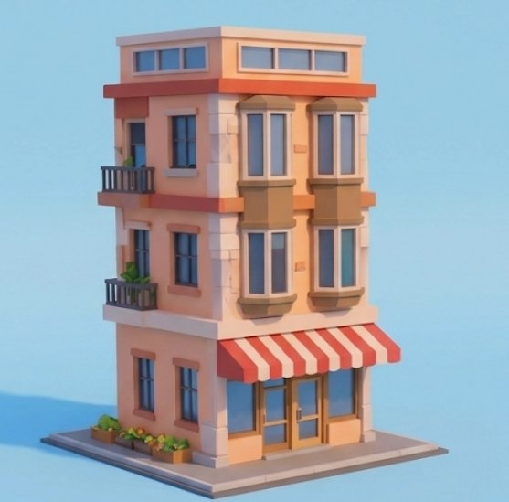 | 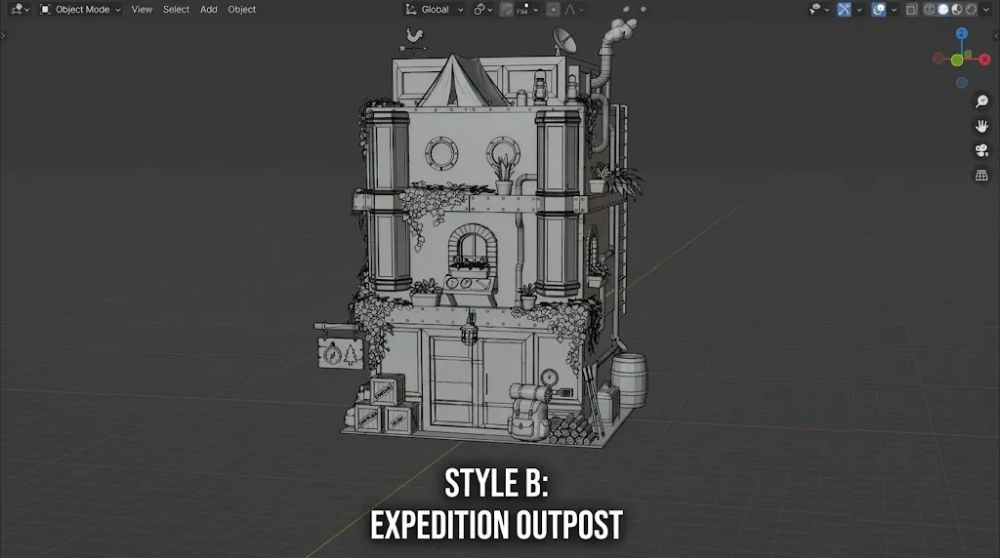 |
| *Original cozy orange house idea* | * Inspo for the camp roof & props* |

---

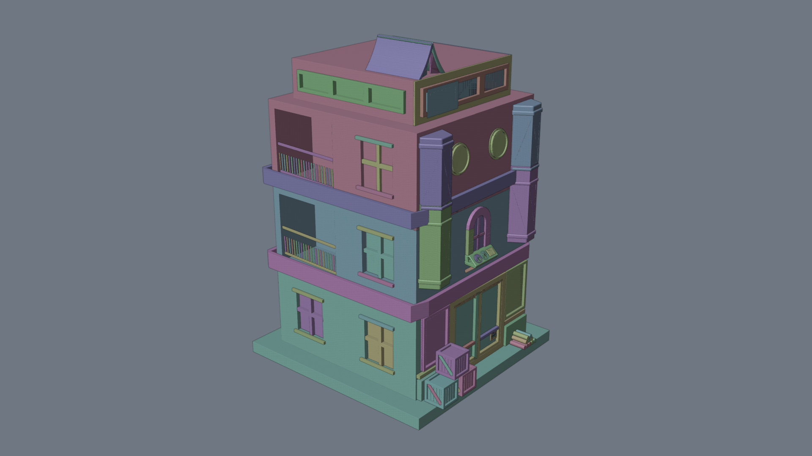

- **Hackatime:** [Expedition Outpost](https://hackatime.hackclub.com/?project=expedition+outpost)
- **Printables:** [expedition-outpost](https://www.printables.com/model/1930053-expedition-outpost)
### Lapse: [Lapse 1](https://lapse.hackclub.com/timelapse/5gMjeaySzRgU) • [Lapse 2](https://lapse.hackclub.com/timelapse/waWgyWxghDyp) • [Lapse 3](https://lapse.hackclub.com/timelapse/YOqTFVAYcSKX) • [Lapse 4](https://lapse.hackclub.com/timelapse/JsHzHuTzYA3Y) • [Lapse 5](https://lapse.hackclub.com/timelapse/j7US5kIwX10x) • [Lapse 6](https://lapse.hackclub.com/timelapse/i70DBfXLXbXC) • [Lapse 7](https://lapse.hackclub.com/timelapse/1aij_S8ncqzF)
- **Active Modeling Time:** **7h 47m 56s** <mark>with 7 lapse/lookout sessions </mark>
- **Printables STL:** [`production/expedition_outpost_printable.stl`](production/expedition_outpost_printable.stl)

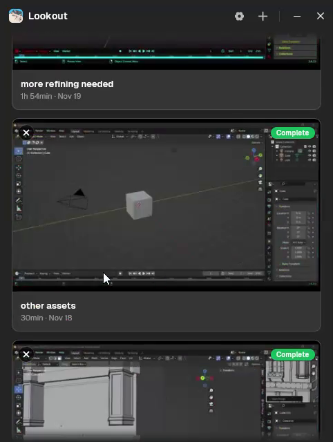

## Models Overview

hellos here's an overview of this really cooler than the Alaska outpost , it's a damn cozy and stylish outpost which started off with a Pinterest inspo to be exact which I found while in search of something where I can practice more and improve my skill , That being said halfway through I didn't want it to be a Random Generic model so I used the help of AI.

Halfway through I used the magic wand (which is the free AI model). I wanted to give the home really cool outdoor camp vibes (credit- inspired by [new survive ysws](https://survive.hackclub.com/) tbh), so at the end we got (**Style B: Expedition Outpost**) and midway we got a new mission to turn THIS INTO EXPEDITION OUTPOST.

Basically, it's a 3-story building that you can live in and camp out on top of. It's packed with a rooftop camping tent, wooden shipping boxes, campfire logs, safety railings, and a Walking Window, the nose of the outpost.

Across its three floors, here is what's on the outpost:

- **Ground Floor:**
  - Front gate doors
  - The windows
  - Wooden boxes with hollow groove lines (`Alt + E`) and the chimney
  - A stack of firewood outside the home for when it's too cold
  - The dustbin
- **Second Floor:**
  - Divider belts between each section of the home
  - 7-sided hollow sleek windows
  - 2 balconies on the left side with their safety grills
  - **Walking Window** (placed right below at the center; arched window with cross bars, a lap/little bib below in the middle, and little legs)
  - Clocks / compasses
  - That other knife-cut thingy (`idk what it is? tho`)
- **Third Floor & Roof:**
  - The eyes of the expedition outpost (with the Walking Window placed at right center, which gives it hella vibes)
  - Rooftop multi window room
  - Rooftop camping tent with triangular tent gates/doors

Although i would try to cover everything as i can i would like to say i am not writing all the things 1 by one its just a journal which covers all the things i made and the hurdles i faced while making the 3d model.

Here is the build log broken down into 7 sessions:

| Session | Lapse / Lookout Title | Date | Time | What Was Made |
| :---: | :--- | :---: | :---: | :--- |
| **1** | `orange home` | Nov 17 | **1h 04m** | • Ground base plane • `I` (Inset) + 3-floor extrusions • Top-floor windowed room (`P` separate + loop cuts: 1 side tested, then 3 at once) • Normal window structure & bottom entrance framing • Sliced front gate wall & carved matching window cubes |
| **2** | `worked for the door` | Nov 17 | **48m** | • The thingy below the windows (`Add Cube`) • Front home gates (made with the same technique as the side windows, with more things layered into it) |
| **3** | `almost complete` | Nov 17 | **1h 31m** | • Front doors & the other few things in the front • Floor divider belts (`Shift + D` + `Bridge Edge Loops`, cloned up between floors) • 7-sided cylinder windows (`P` + extrude/intrude + duplicated) • 2 left-side balconies (loop cut + extrude) • Side-wall windows with center bars (copied one-by-one for exact size) |
| **4** | `almost all assets` | Nov 17 | **1h 30m** | • **Walking Window** (2 blocks + `Spin` + `Bridge Edge Loops` arch, back plane, `Add Cube` cross, extruded lap & little legs) • **Dustbin** (feet + 45° tilted top + extruded front & small thingy at slanted side) • **Chimney** (cylinder cutout + top grill) • **Clocks / Compasses**, Knife-cut thingy (`idk what it is? tho`) & **Eyes of the outpost** |
| **5** | `other assets` | Nov 18 | **30m** | • Wooden boxes with hollow groove lines (`Alt + E`) • Stacked campfire firewood logs • Early explorer backpack draft *(saved for v2)* |
| **6** | `more refining needed` | Nov 19 | **1h 54m** | • Attached all props onto the outpost (eyes, Walking Window + lil bib, clocks, the other something idk, dustbins, chimneys, boxes, firewood logs) • **Rooftop Tent** (separated each side with `P`, bent cleanly via `Simple Deform` Bend & joined) • Triangular tent gates/doors cut with Knife tool (`K`), duplicated & placed on roof |
| **7** | `see` | Nov 20 | **24m** | • Modeled and aligned safety grills onto the balconies • Completed final 185+ part outpost assembly |
| **Total** | | | **7h 47m 56s** | **Over 185 individual mesh pieces/sub-parts that make up the 1 outpost model** |

---

## The Build Log

### Phase 1: Making the base, 3 parts & window experiments (`orange home`, 1h 04m)
### Lapse: [Lapse 1](https://lapse.hackclub.com/timelapse/5gMjeaySzRgU)

Here is the original Pinterest image that lead the whole journey:

1. Started off by making the plane where the structure was sitting.
        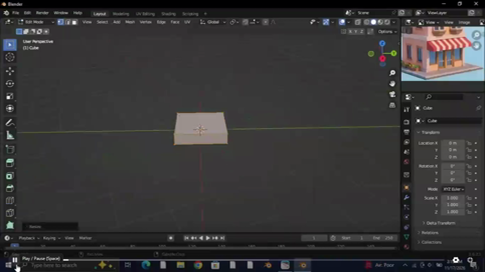

2. Then I used the **I tool** (inset), and as per the size of the home, I carved out the base and did the extrusions till i reached the desired size.
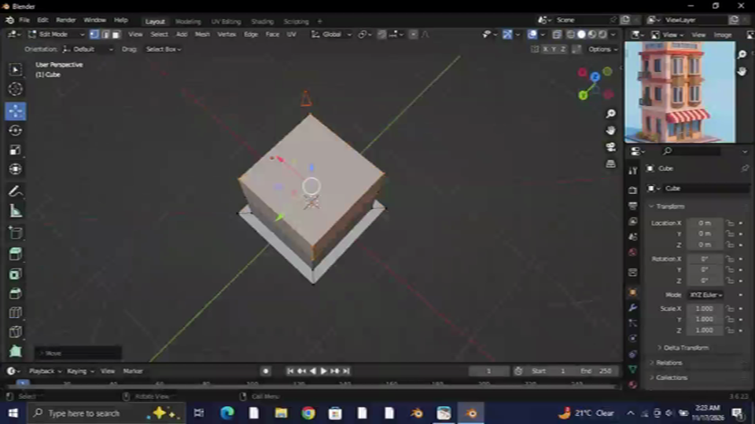

3. Also a thing was that I extruded and stopped right where I thought the base portion gate and window should be, Similarly, I made 3 parts/floors with the help of it.

4. Usint the same technique of insetting and extruding, I made the most windowed room of the structucture. at the most up floor , Then using the same loop cuts and the ** P tool **
( which helps in seperating the faces / objects) firstly i tried with the one size of the four And i thought:*will it work as per I thought?* And it worked!
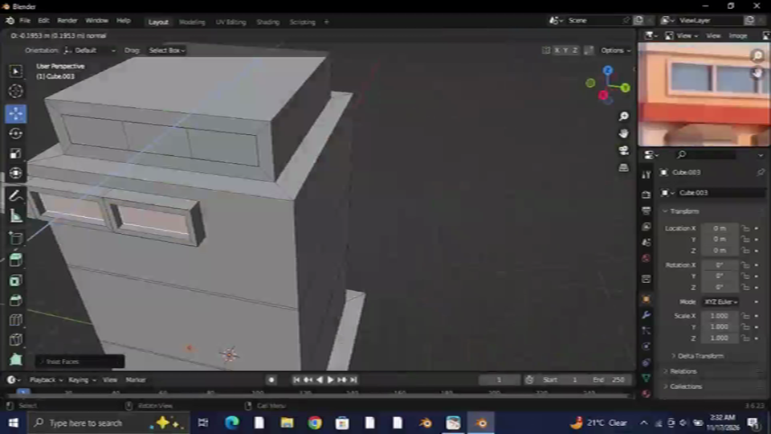

5. Then I replicated teh same thing with selecting all the other faces but now all 3 of them at once,first separating and hen using the same steps of loop cutting, insetting . and extruding the face , trying to replicate the same sizes as earlier experiment. At last, I made the normal window structure and framed the bottom entrance. 
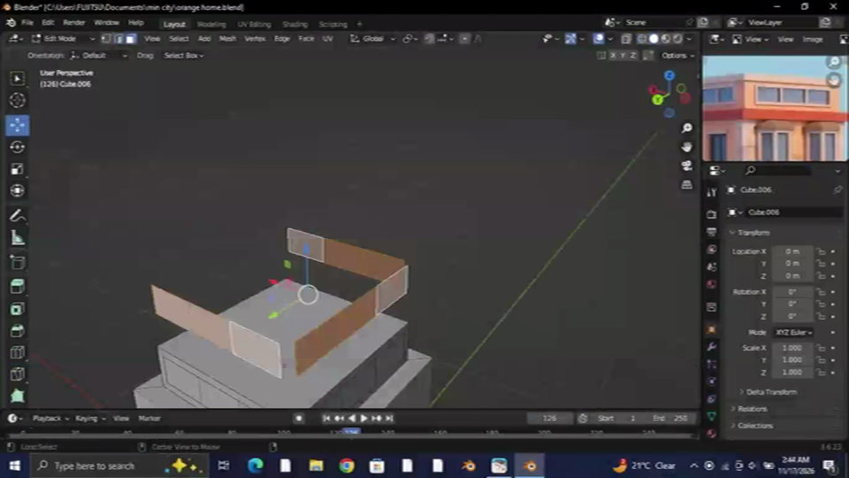

6. At last i used the loop cut or slicing tool may be to seperate the portion of the front gate side in half and then i used the add cube tool to match the same size as the window and then i took that cubes of windows and carved out it as similar to a window as it should be 
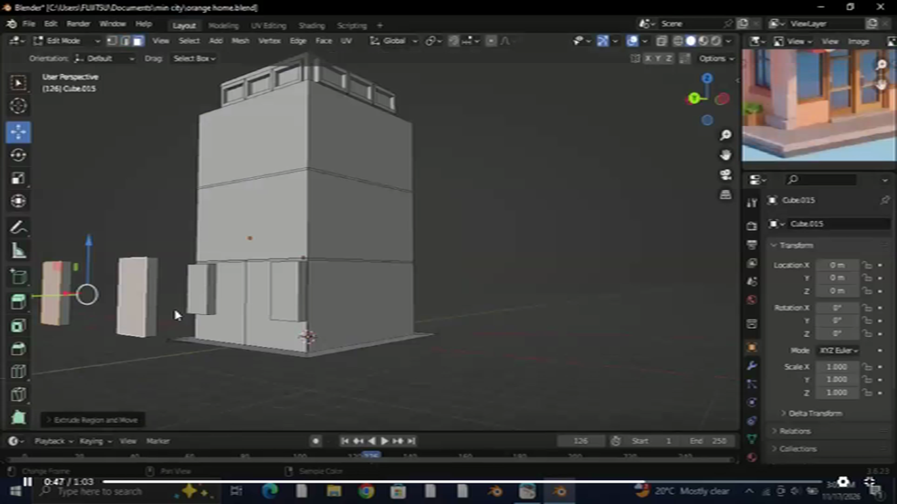

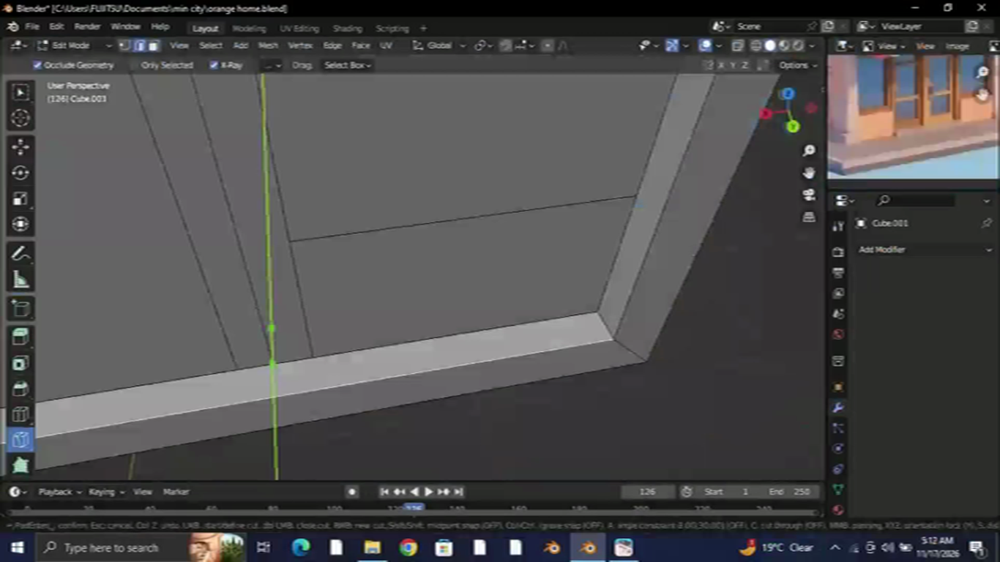

---

### Phase 2: The windows & the home gates (`worked for the door`, 48m)
### Lapse: [Lapse 2](https://lapse.hackclub.com/timelapse/waWgyWxghDyp)
1. Started by making the thingy which are below the window using the add cube tool
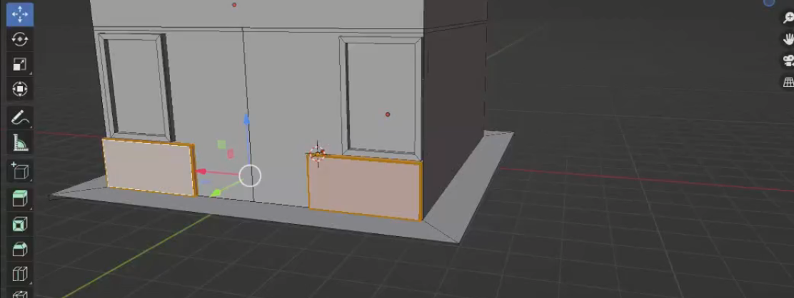

2. Then I worked on the home gates. It wasn't as polished as in the image, but still it was made by the same technique via which the side windows are made, just with more things layered into it. So Session 2 was easy peasy!
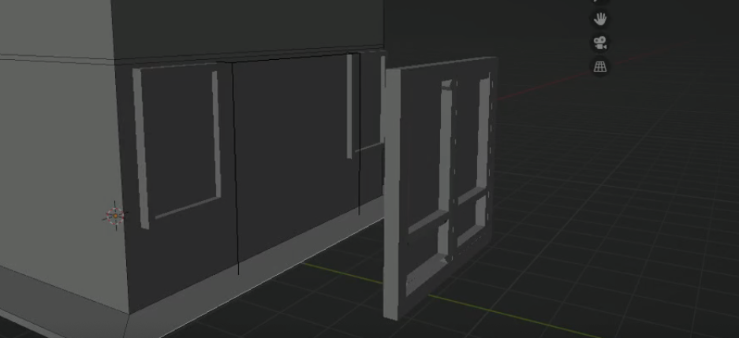

---

### Phase 3: Belt of the home, balcony & cylinder windows (`almost complete`, 1h 31m)
### Lapse: [Lapse 3](https://lapse.hackclub.com/timelapse/YOqTFVAYcSKX)

1. For the phase 3 i started by adding the doors and the other few things in the front.

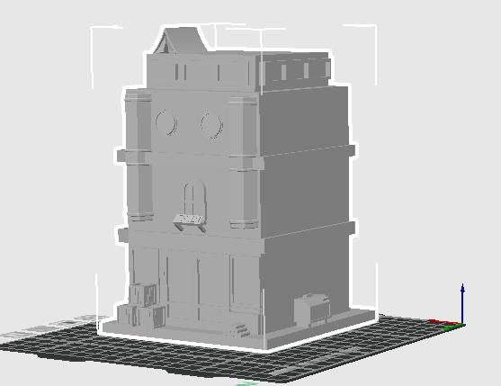

2. then added the cube to make the belt which are between each section of the home , using the shift d and few adjustments around the corner and using the bridge edge loops i made the some what similar belt around it, then selecting and cloning the belt i moved it up between other sections.
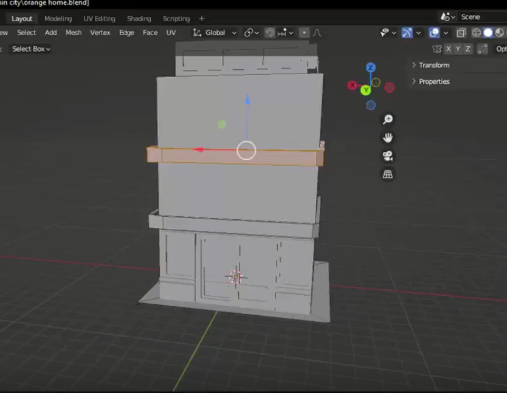

3. After than i moved to make those special 7 sides windows 
i kinda knew what to do in this one so didnt took that, much time used the cylinder , reduced the sides to 7 , then like used the p section tool and then used the extrusion entrusion to make that hollow sleek style of the windows and ,,, Volla completed the window 

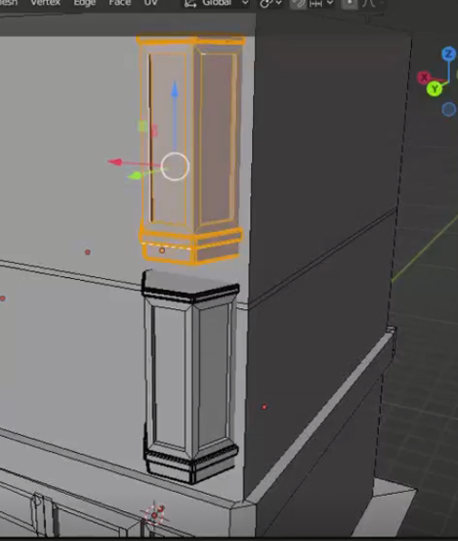

and then duplicated it to other sides to make it perfect !!!

4. Then moved forward to make those balcony on the left side of the home using some loop cut and extrusion our 2 balconies were ready
                    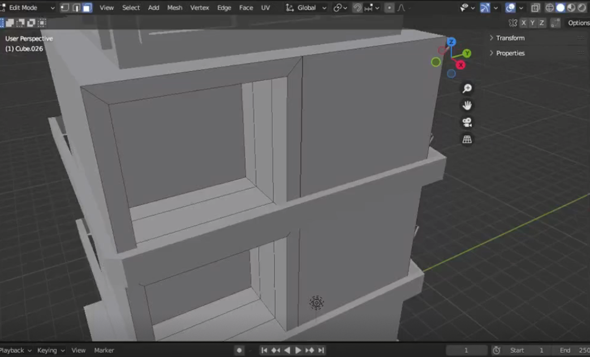

5. At last moved on to make the windows of the side wall used the i tool to make the same size of the side as indow then used the carving extrusion and intrusion to give it the shape of thte window then added the window lines middle one ,
After than i tried to do the all other 3 sides as once but it was not working out so i did one by one using entusinon and etc also i copied the whole window previeously made to match the extact size ....
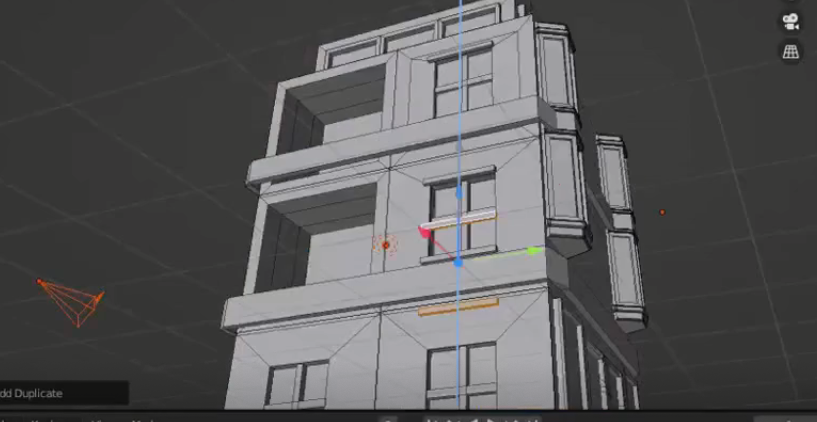

---

### Phase 4: Worked ont the walking window ( its compass and other asets), chimneys and the outpost eyes and etc(`almost all assets`, 1h 30m)
### Lapse: [Lapse 4](https://lapse.hackclub.com/timelapse/JsHzHuTzYA3Y)

**Walking Window**

1. starded of by laying 2 blocks for the upper curved part of the window and used the spin tool to make a wole curved portion off it at end to join the blocks i used the bridge edge loops.
           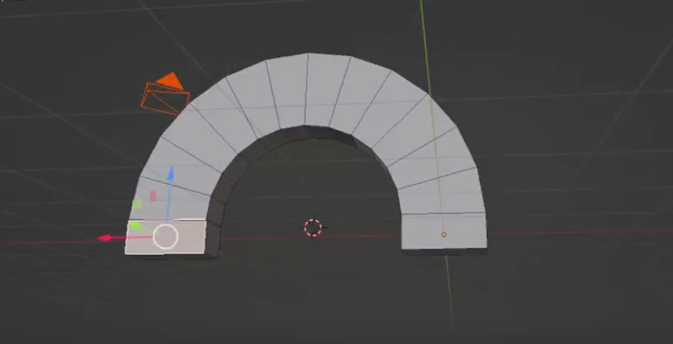

2. Then worked one selecting the end faces of the blocks and extruding it , Till the desired size . and then worked ont the adding the plane to its back , And then adding the cross using the add cube tools. 
          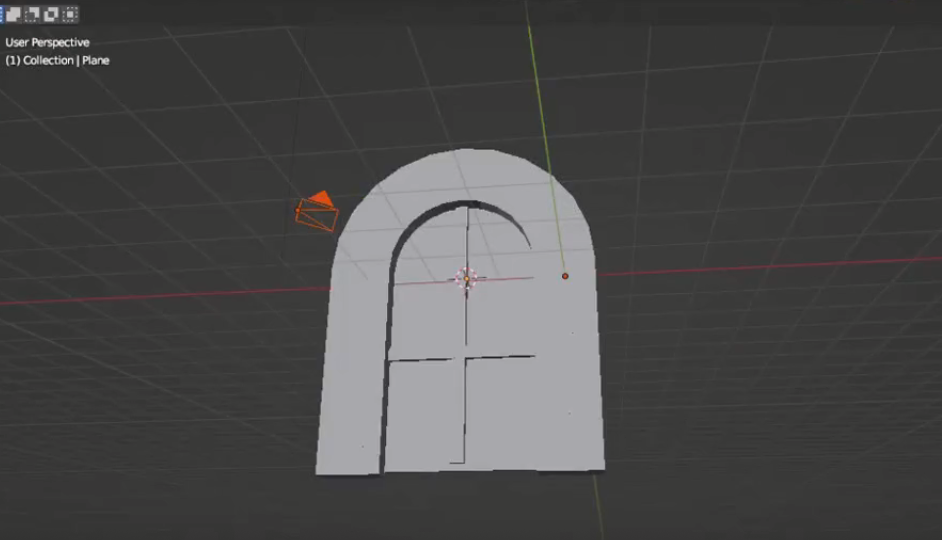

3. Then used the plane to make the lap for the window and then extruded it to the desired with and then extruded it with the last edge side of it , and several other steps then worked on adding the legs of the window at last it turned out too be kinda nice!!!
        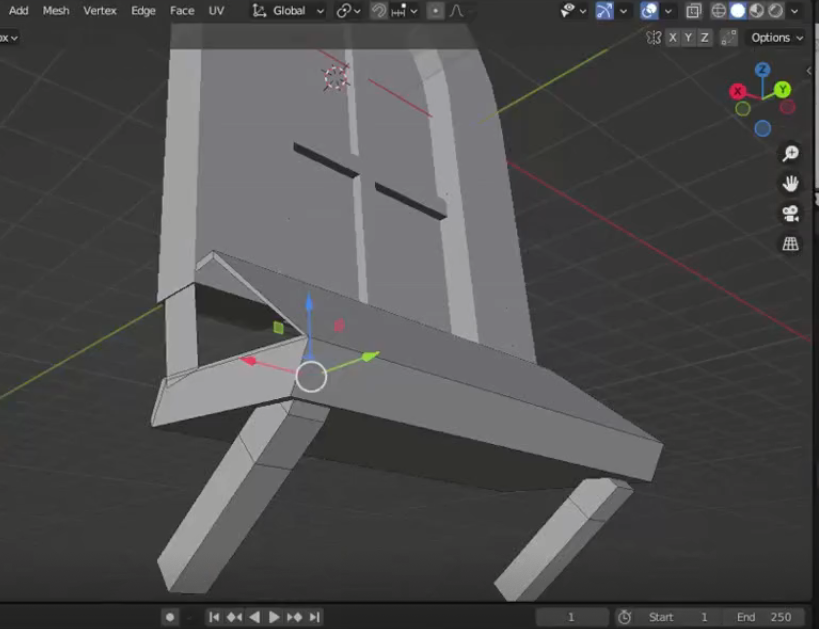

**The Dustbin&chimney**

1. Worked on creating the dusbin firstly used the as always square to make it lil bit rectangular then addedd the feets of the dustbin and tilted the upperportion of the dustbin to 45 degrees and extruded int he front portion and at last added the small thingy at the slanded side of it .

    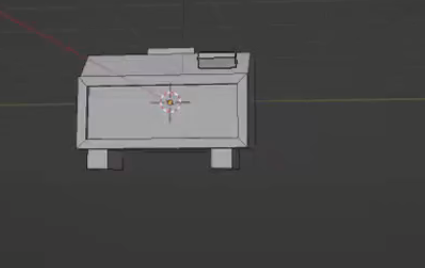

2. For the chimney added the desired shaped square similar to the chimney and then added the cylinded to do deletion of 
desired shape in the sqare and then added the chimney grill at end .
                                               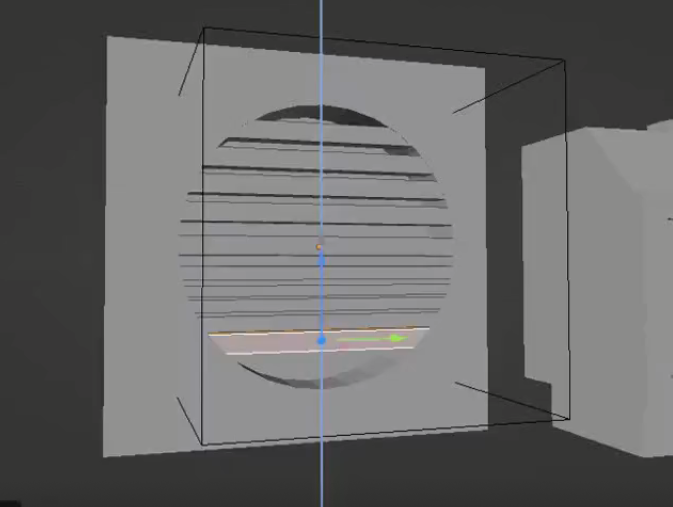

**Clock/Eyes and other assets**

1. Firstly, for the window leftovers.
made the clock/compass looking object using the cylinder , and then carving out the desired shape and then adding the other cylinder as middle nossel and hten adding the stick thingy for the clock then similarly made the other ones too,
then made the other thingy using the knife tool and extruding out the sides idk what it is ? tho
                                                                                            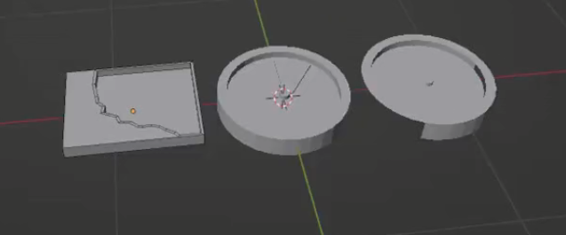

2. AT last, made the eyes for Our expedition outpost using the same steps as used in clock one almost..
             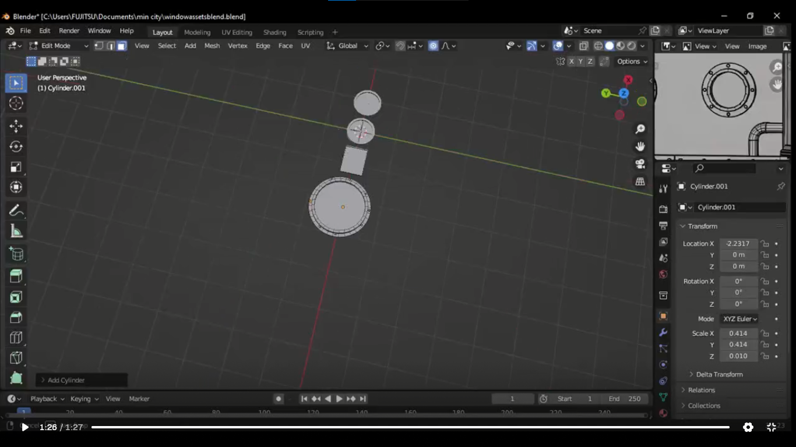

### Phase 5: Slatted boxes & campfire logs (`other assets`, 30m)
### Lapse: [Lapse 5](https://lapse.hackclub.com/timelapse/j7US5kIwX10x)

1. **The boxes in front of the home:** Made the wooden boxes with hollow groove lines using **`Alt + E`** to push the slats inward while keeping the outer frame solid.
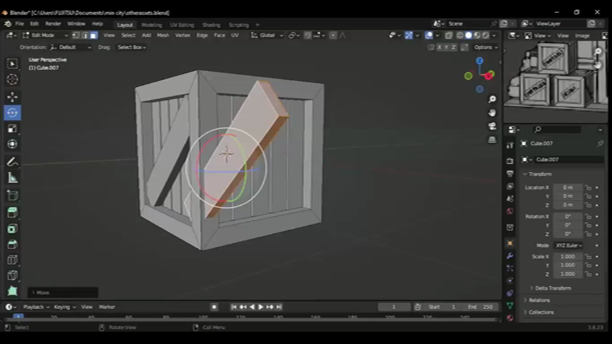

2. **Campfire logs:** Worked on making a stack of firewood logs outside the home for camping out.
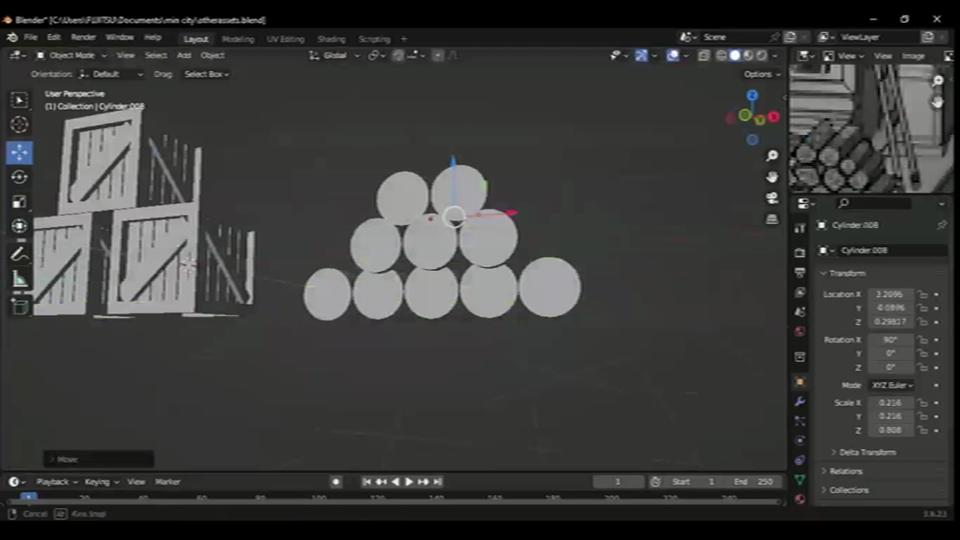

3. **The explorer bag:** Tried making the back pack too, but decided to save it for a future v2 update instead of rushing it here.

---
### Phase 6: Adding all the assets made previously in the outpost (`more refining needed`, 1h 54m)
### Lapse: [Lapse 6](https://lapse.hackclub.com/timelapse/i70DBfXLXbXC)

**All assets Joining/Attaching**

1. Started of by adding adding the eyes to the right position of the outpost , After wards which worked on adding the walking window to the , Right center of the eyes and lil bib below to the middle portion. And then added the assets such as the clockes and the other something idk. Then worked on adding the other side dustbins and the chimneys each boxes and the firewood logs.

2. After that my biggest huddle till this project , Worked on making the tent i firstly tried just making the tent flat but it would not match the reference then i used the simple bend tool . ** The biggest problem with that** 
was when i am using the loop cut and then trying to bend the side one side is bending good but other ones are keep messing up For a quiet while i jargled with fixing it . 
and suddenly its clicked why not us our p tool to sperate teh sides which we made and then after selecting the each side with the loops lines of it i detached them from each other and wheni bend the each side it was bending quite well . and tehn i just joint them .
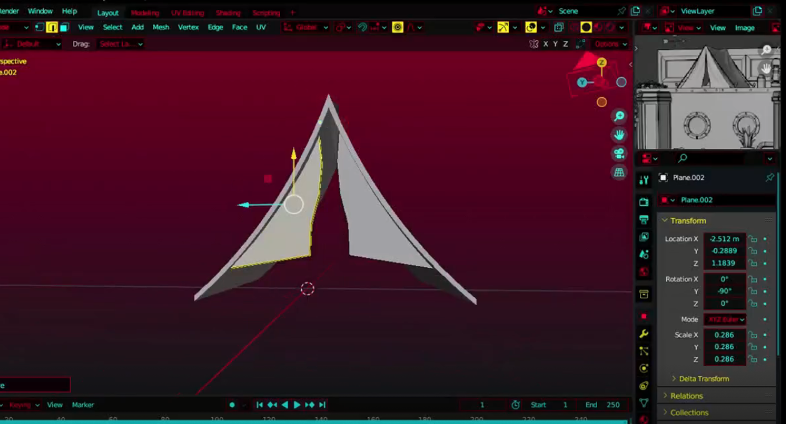

3. After which at last i worked on making the like gates of the tent i used the square plane , scaled it well and using the kife tooll i made it triange and after doing some tweaks to its shape i made teh gate of the tent and then duplicated it to other sides and rotated it well and then duplicated both to the other side of the tent . and Finally added it to the roof.
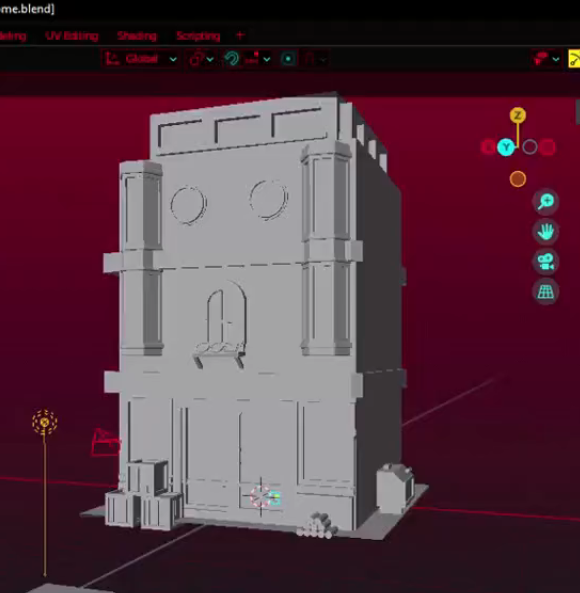

---

### Phase 7: The final alignment (`see`, 24m)
### Lapse: [Lapse 7](https://lapse.hackclub.com/timelapse/1aij_S8ncqzF)

1. **Making and Positiong of the balcony grills:** Workend on the last lapse fot the making of the grills for thebalcony and aligning to the balconies.
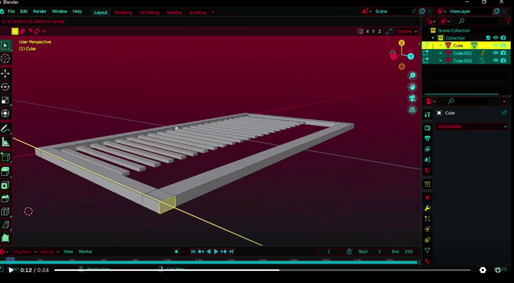

---

## Links: BOM & AI Disclosure

- **Bill of Materials:** [`BOM.csv`](./BOM.csv)
- **AI Disclosure:** [`AI_USAGE.md`](./AI_USAGE.md)

---

## Final Render

### Colourfull
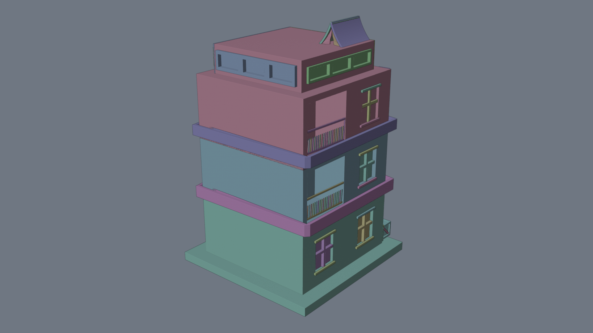
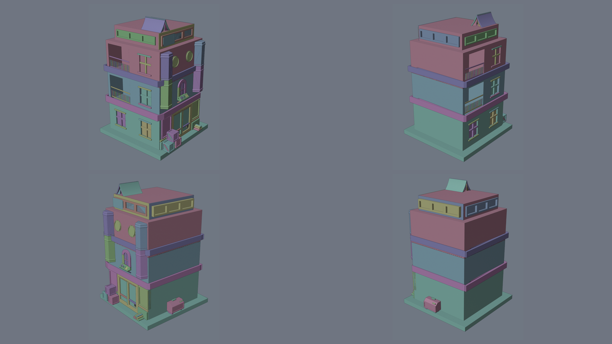

### Colorless 
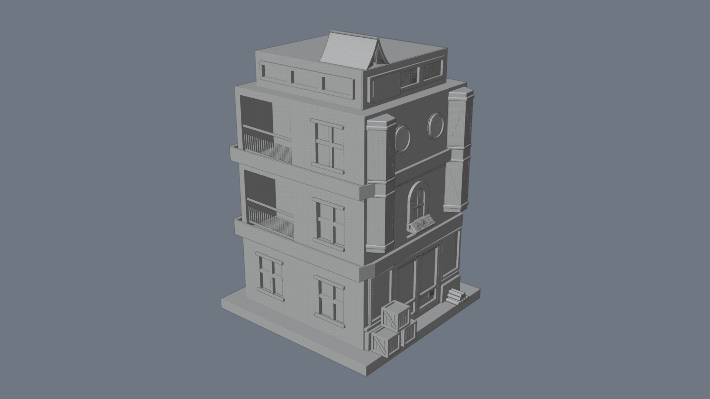
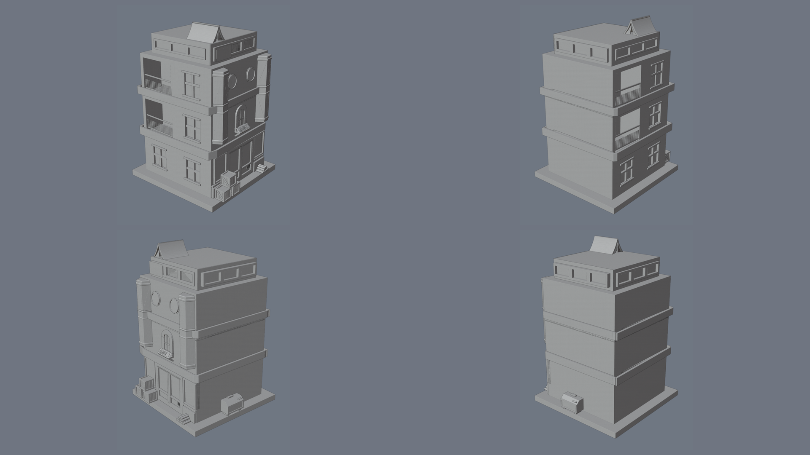

----------------------------------------
   arigatō gozaimasu🙇
Thanks for reading this/////
